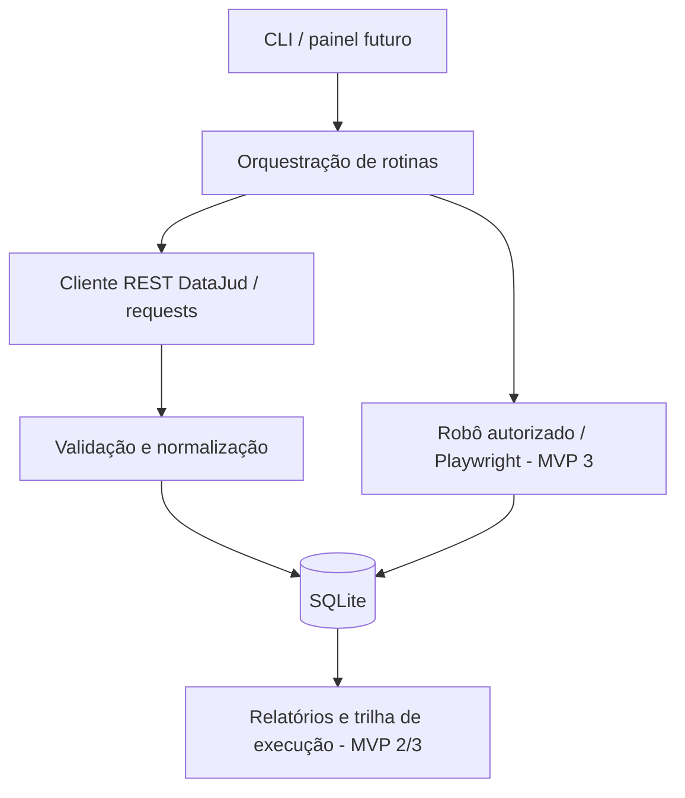

# ADR 0001 — Arquitetura modular híbrida (API + RPA)

**Data:** 2026-11-12  
**Estado:** Aceita para o planejamento inicial; revisável após teste real de integração.

## Contexto

Projeto de portfólio em Python voltado a competências relevantes para estágio em automação (RPA). O produto deve resolver uma necessidade plausível com **fontes oficiais reais**, mas respeitar condições de uso, privacidade e a disponibilidade de um computador modesto. O DataJud fornece metadados via API REST; o PJe/TJPE possui superfícies próprias que não são presumidas como livres para scraping.

## Decisão

1. **Monólito Python modular**, com interface CLI inicialmente, sem microserviços, nuvem obrigatória ou Docker.
2. **Integração REST oficial** via `requests` para consulta pontual aos metadados de processos públicos do TJPE, com chave pública configurada por variável de ambiente.
3. **Normalização e modelo de domínio** desacoplados de HTTP e SQLite.
4. **Persistência SQLite** para processos e rastreabilidade das consultas; manter dados fora do Git.
5. **Playwright como motor de RPA** em etapa posterior, restrito a interfaces próprias ou explicitamente autorizadas. O fluxo RPA deve operar uma interface e executar ações com verificações/evidências; chamar uma API, sozinho, não caracteriza RPA de interface.
6. **Testes offline com doubles HTTP** para reproduzibilidade. Teste live é manual, sujeito a rede, chave vigente e regras do CNJ.
7. **Simplicidade primeiro**: sem scraping de Jusbrasil ou burla de controles; PJe-MNI só mediante acesso autorizado; sem automação para prazos ou intimações.

## Diagrama lógico

## Trade-offs

- Consulta HTTP é mais estável que navegação visual para captar dados; o RPA tem foco em operações que exigem uma interface de trabalho.
- SQLite simplifica a instalação, mas não serve para múltiplos escritores remotos simultâneos. Uma migração futura para PostgreSQL exige justificativa.
- Dados reais ampliam utilidade, mas impõem responsabilidade sobre termos de uso, temporalidade e privacidade. Apenas subconjuntos de metadados são persistidos.
- Consulta pública do PJe e MNI não são dependências do MVP: acesso automatizado pode exigir autorização, autenticação ou interação humana.

## Fronteiras / não objetivos do MVP 1

Sem Playwright, agendamento, monitoramento contínuo, alertas jurídicos, scraper de Jusbrasil, cadastro de partes, API comercial, dashboard ou publicação de dados coletados. Esses itens não são apresentados como funcionalidades já concluídas.

## Critérios para revisão

Revisar o contrato de parsing e a estratégia de identificadores após resposta real do TJPE; atualizar o ADR caso os documentos retornados exijam campos adicionais ou restrições de uso.
